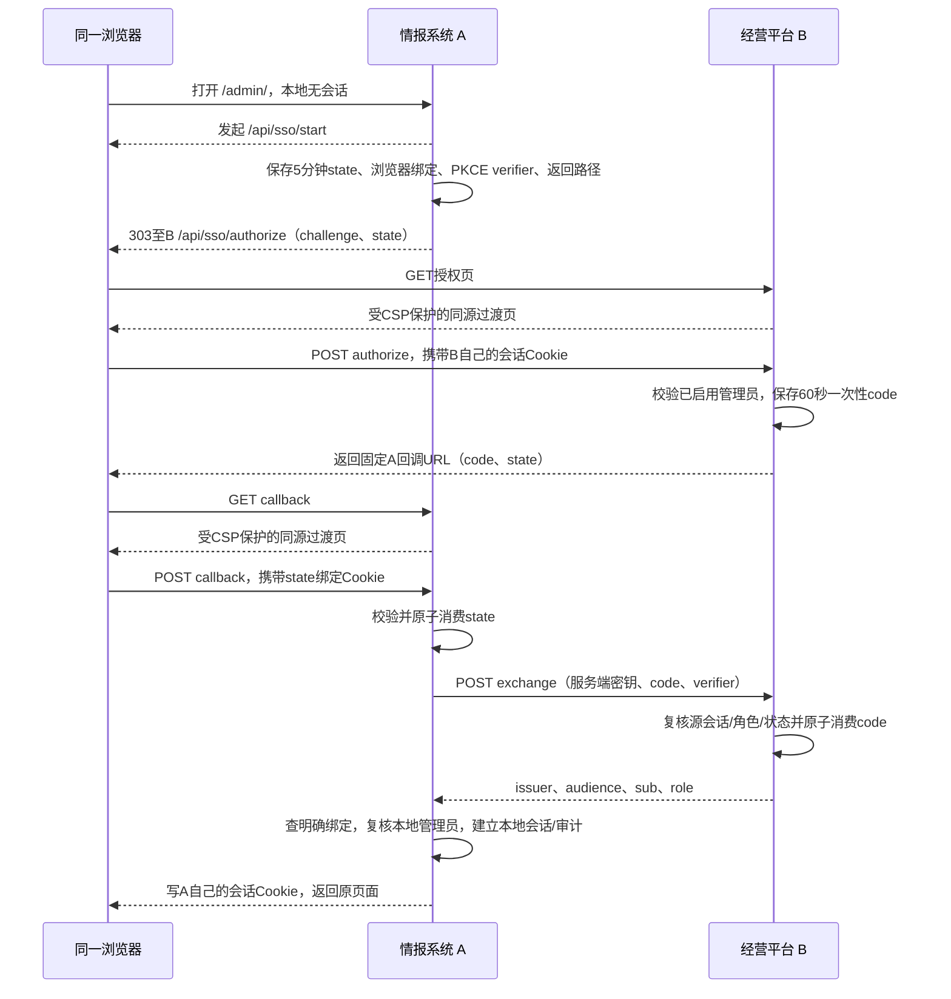

# 情报系统与全球电商AI经营平台管理员单点登录对接

协议版本：Bilateral Admin SSO Bridge v1。日期：2026-10-21。供双方后端、前端及联调人员使用。

目标是在同一浏览器中，管理员已登录任一系统后，打开另一系统即可自动建立该系统的本地会话。情报系统顶部“全球电商AI经营平台”按钮直接访问 `https://ai.chatviva.com/admin/`，由目标系统检测自身会话并发起单点登录。

情报系统这一侧已提供以下协议实现，默认关闭，尚未上线。经营平台按本协议实现对称接口，双方完成账号绑定和隔离联调后再启用。本文约定的是双边一次性授权码身份交换协议，**不是完整 OAuth/OIDC 身份服务**；不返回 OAuth access token、refresh token 或 OIDC ID token，不接收双方普通业务 Token，也不共享密码、数据库或 Cookie。

## 1 系统标识与固定地址

| 项目 | 情报系统 A | 全球电商AI经营平台 B |
| --- | --- | --- |
| 系统标识 client_id | `intelligence-system` | `chatviva-admin` |
| HTTPS origin | `https://is.luckdate.com` | `https://ai.chatviva.com` |
| 管理后台 | `https://is.luckdate.com/admin/` | `https://ai.chatviva.com/admin/` |
| 发起接口 | `/api/sso/start` | `/api/sso/start` |
| 本地会话授权接口 | `/api/sso/authorize` | `/api/sso/authorize` |
| 授权码兑换接口 | `/api/sso/exchange` | `/api/sso/exchange` |
| 固定回调地址 redirect_uri | `https://is.luckdate.com/api/sso/callback` | `https://ai.chatviva.com/api/sso/callback` |

以上 B 系统地址是供对方实施的接口约定，不表示其当前线上已有这些接口。若对方路由存在冲突，应在联调前统一修改双方实现及本表。

`origin` 和 `issuer` 不含尾斜杠。`redirect_uri` 必须逐字匹配对方预登记的固定回调，禁止通配符、用户传入新域名和动态回调。源系统是当前已有登录会话并签发授权码的一方；目标系统是当前正在打开并创建新本地会话的一方。双方在两个方向上交换这两种角色。

## 2 双方需要实现的内容

1. 各保留原账号密码登录、角色权限和本地会话管理。
2. 实现四类路径，共六个HTTP方法组合：GET start、GET/POST authorize、POST exchange、GET/POST callback。
3. 打开后台时，先检查本地会话；仅在未登录且已开启SSO时，自动进入本系统 start。每次进入最多自动尝试一次；对方没有会话或失败后回到普通登录，不能两边循环跳转。
4. 两边都存储明确的账号ID绑定；绑定双方已有且启用的管理员，不按用户名或邮箱自动认领，也不自动创建账号或提升权限。
5. 共同生成一份独立随机共享密钥，通过双方认可的安全渠道交换，保存在服务器环境变量或密钥服务。不要把密钥发送到浏览器、URL、文档、代码仓库或普通访问日志。
6. 对方后台可加入返回情报系统的链接 `https://is.luckdate.com/admin/`。即使从收藏夹直接打开，目标系统的自动尝试机制也应生效。

本期实现本地退出：退出本系统后，该页面携带 `sso=skip` 保持在本地登录页，允许用户主动再次SSO登录。另一系统的既有会话不自动退出。全局单点退出、账号自动同步及权限自动同步不在v1范围；要禁用跨系统访问，应在两边停用账号/撤销会话或移除绑定。

## 3 登录时序

以 B 已登录、打开 A 为例；反方向将 A/B 对调。



普通登录只需一次输入密码。两个域名分别维护 Cookie；不能通过 `document.cookie`、localStorage、第三方 iframe 或向 URL 放长期 Token 来共享登录状态。

## 4 随机值与有效期

| 字段 | 格式/生成方式 | 有效期/要求 |
| --- | --- | --- |
| `state` | CSPRNG 32字节，base64url无填充，43字符 | 5分钟；目标系统保存并与浏览器随机Cookie绑定；原子单次消费 |
| `code_verifier` | CSPRNG 32字节，base64url无填充，43字符 | 仅目标服务端保存，不发送给浏览器或写URL |
| `code_challenge` | `BASE64URL(SHA256(ASCII(code_verifier)))`，43字符 | 必须 `S256`，不支持plain |
| `code` | CSPRNG 32字节，base64url无填充，43字符 | 60秒；绑定目标client_id、回调、challenge、源用户及源会话；原子单次消费 |
| 共享密钥 | 至少32字节CSPRNG，base64url无填充 | 与业务密钥、部署密钥分开；生产/测试各自独立 |

base64url值允许字符 `A-Z a-z 0-9 _ -`，不带 `=`。数据库只存 `code` 和 `state` 的 SHA-256 哈希作为查找键；state记录中的verifier仅供服务端使用。过期记录可清理，已消费记录不得恢复为未使用。

## 5 发起 GET /api/sso/start

**调用者：**浏览器访问目标系统。无需已有本地登录。

可选查询参数 `return_to`：目标系统内的 `/admin/` 页面及其查询参数。拒绝外站、反斜杠、控制字符、跨出后台的路径和登录页；不合规则回到 `/admin/overview`。

示例：

```text
GET https://is.luckdate.com/api/sso/start?return_to=%2Fadmin%2Fresearch%3Fmarket%3DUS
```

目标系统先保存state及其浏览器绑定、verifier和返回路径，再设置短期浏览器绑定Cookie，响应 **303**，Location为源系统授权地址。示例中的花括号是说明占位符，实际必须替换为合法43字符随机值，并通过URLSearchParams编码：

```text
https://ai.chatviva.com/api/sso/authorize?client_id=intelligence-system&redirect_uri=https%3A%2F%2Fis.luckdate.com%2Fapi%2Fsso%2Fcallback&response_type=code&state={state}&code_challenge={challenge}&code_challenge_method=S256&prompt=none
```

A侧绑定Cookie名为 `__Host-is_sso_` 加state前12字符，值为另一份32字节随机值；state记录存其哈希。属性为 `Path=/; HttpOnly; Secure; SameSite=Lax; Max-Age=300`，不设置Domain。B可使用自己的Host前缀Cookie名。每个state独立Cookie支持多个标签页。

## 6 授权 GET 与 POST /api/sso/authorize

**调用者：**浏览器访问源系统。本接口只检查本系统已有登录，不能在授权过程中再去调用对方SSO，也不能向第三方地址跳转。

| 参数 | 类型 | 固定值/含义 |
| --- | --- | --- |
| `client_id` | string | 目标系统标识，精确匹配登记值 |
| `redirect_uri` | string | 目标系统固定callback地址 |
| `response_type` | string | `code` |
| `state` | string | 目标系统生成的43字符随机值，回调原样返回 |
| `code_challenge` | string | 目标系统生成的43字符S256摘要 |
| `code_challenge_method` | string | `S256` |
| `prompt` | string | `none`，仅复用已有登录 |

GET校验参数后返回200 HTML过渡页。该页不加载第三方资源；以 `credentials: 'same-origin'`、`Content-Type: application/json` 将上述字段原样POST至本系统同一路径。这样源系统原有 `SameSite=Strict` 会话Cookie可在同源请求中使用，无需减弱现有会话Cookie策略。POST必须校验 `Origin` 精确等于本系统HTTPS origin。

POST成功响应200：

```json
{
  "redirect": "https://is.luckdate.com/api/sso/callback?state={state}&code={code}"
}
```

浏览器使用 `location.replace(redirect)` 进入固定回调。返回的 `redirect` 必须由服务器使用已登记的地址构造，不信任浏览器传入的任意跳转地址。

本地没有有效会话时同样返回200，但使用：

```json
{
  "redirect": "https://is.luckdate.com/api/sso/callback?state={state}&error=login_required"
}
```

本地账号停用、角色不是管理员或不满足授权条件时，回调 `error=access_denied`，不签发code。非法client_id、回调、challenge、state或prompt直接400，不向未经验证的回调重定向。

## 7 兑换 POST /api/sso/exchange

**调用者：**目标系统后端直接请求源系统后端。禁止浏览器代调；双方不开放跨域CORS。验证HTTPS证书，不跟随重定向，不自动重试。

请求头：

```http
Content-Type: application/json
Authorization: Bearer <双方独立约定的SSO共享密钥>
```

请求体（A向B兑换）：

```json
{
  "grant_type": "authorization_code",
  "client_id": "intelligence-system",
  "redirect_uri": "https://is.luckdate.com/api/sso/callback",
  "code": "{43字符code}",
  "code_verifier": "{43字符verifier}"
}
```

源系统依次校验共享密钥、client_id、固定回调、code有效期/未消费、S256匹配；并重新查询源管理员和签发时的源会话，确认仍启用、仍是管理员、会话未退出/撤销/超时。通过后使用数据库条件更新原子消费code，仅影响1行才成功。不能采用“先查询未使用，再无条件删除/标记”的并发写法。

成功200响应（B是签发方）：

```json
{
  "protocol_version": "1",
  "issuer": "https://ai.chatviva.com",
  "audience": "intelligence-system",
  "sub": "{B系统不可变管理员ID}",
  "role": "admin"
}
```

`sub`必须为JSON字符串，以不可变账号主键为准，禁止用用户名/邮箱代替。对方如使用数字主键，输出其十进制字符串。此响应只能被刚完成兑换的目标服务端使用，不是可复用的浏览器凭证。

目标服务端严格校验版本、issuer、audience和role，然后按绑定表查询自己的本地管理员。找不到绑定、账号被停用或角色不符，均不能创建会话。对方权限不能覆盖本地权限。

| 状态码 | 含义 | 目标系统处理 |
| --- | --- | --- |
| 200 | 成功，返回身份 | 校验全部身份字段及本地绑定 |
| 400 | code过期、已使用、不匹配、已撤销或请求格式错误 | 返回普通登录，不重试同一code |
| 401 | SSO共享密钥错误/缺失 | 返回普通登录，服务端检查配置 |
| 404 | SSO未启用或不存在该路由 | 返回普通登录 |
| 413 | 请求大于8KiB | 拒绝，检查实现 |
| 429 | 请求过多 | 等待后允许用户手动重试 |
| 503 | 数据库维护中 | 返回普通登录或稍后重试入口 |

错误JSON结构为 `{"error":"面向用户的简短原因"}`，消费者按HTTP状态处理，不依赖中文文字做程序判断。A侧兑换超时10秒，响应体限8KiB。

## 8 回调 GET 与 POST /api/sso/callback

**调用者：**浏览器回到目标系统。

GET参数为 `state` 加 `code`，或 `state` 加 `error`（`login_required`/`access_denied`）。GET校验state格式并返回200同源HTML过渡页；该页将参数以JSON POST到本系统callback。POST精确校验Origin并携带目标系统自己的Cookie。

目标系统处理顺序：

1. 查询未过期、未消费的state，校验浏览器随机Cookie哈希，再原子消费state；缺Cookie、错Cookie或过期不得登录。
2. 对方回调error时回普通登录，不向对方发兑换请求。
3. 成功code交由服务端兑换，验证身份并查本地绑定、启用状态、管理员角色。
4. 如浏览器在另一标签页已登录不同本地账号，拒绝替换；提示先退出已有账号。GET过渡页后的同源POST可以正确识别原有Strict本地会话。
5. 复用本系统正常登录建立新的随机会话，写HttpOnly/Secure本地Cookie，记录SSO登录审计。保留各系统自己的会话超时策略，不能接受客户端传入的用户ID/角色作为身份依据。
6. 清除对应state Cookie，以200 JSON返回本地页面地址，过渡页再执行 `location.replace`。

成功POST响应：

```json
{"redirect":"/admin/research?market=US"}
```

A侧无对方会话/拒绝授权的回落为 `/admin/auth/login?sso=unavailable`；兑换失败、绑定缺失或本地账号不可用的回落为 `/admin/auth/login?sso=failed`。目标守卫识别这些标记后**停止自动SSO**，允许本地密码登录及用户手动再次尝试。无效state或浏览器绑定直接400；过渡页保留普通登录链接，不继续授权。

GET/POST过渡响应必须设置 `Cache-Control: no-store`、`Referrer-Policy: no-referrer`、`X-Content-Type-Options: nosniff`，禁止iframe嵌入。HTML使用nonce CSP，connect-src仅self，不加载统计/广告/外部脚本。网关及应用日志不得记录code、state、Cookie、Authorization或完整回调查询串。

## 9 账号绑定与服务器配置

双方通过各自管理员管理功能查找不可变账号ID，在安全管理渠道核对后配置一对一映射。不要传输密码或生产数据库副本。

| 绑定方向 | 配置含义 |
| --- | --- |
| A侧 | `{ "B管理员不可变ID": "A管理员UUID" }` |
| B侧 | `{ "A管理员UUID": "B管理员不可变ID" }`，按B系统本地存储方式配置 |

A侧配置项（仓库中的compose已预留透传，默认关闭）：

| 环境变量 | 值/用途 |
| --- | --- |
| `ADMIN_SSO_ENABLED` | `false`；联调通过后设为`true` |
| `ADMIN_SSO_PUBLIC_ORIGIN` | `https://is.luckdate.com` |
| `ADMIN_SSO_PEER_ORIGIN` | `https://ai.chatviva.com` |
| `ADMIN_SSO_CLIENT_ID` | `intelligence-system` |
| `ADMIN_SSO_PEER_ID` | `chatviva-admin` |
| `ADMIN_SSO_SHARED_SECRET` | 双方安全交换的43～128字符base64url随机密钥 |
| `ADMIN_SSO_ACCOUNT_MAP` | B不可变ID到A管理员UUID的JSON对象，不含密码 |

B侧相同概念反向配置：public_origin为B，peer_origin为A，本地标识chatviva-admin，对方标识intelligence-system。测试域名、密钥及测试管理员须与正式环境隔离；禁止测试流量写正式业务库。除健康检查外，不能将正式x-server-key或原研究访问码用作SSO密钥。

A侧新增表 `admin_sso_tickets`，保存短期state/code及消费标记；启动迁移会创建，不更改业务表。数据库切换期间SSO返回503，进行中的临时state/code不随数据库迁移复制，用户重新发起即可。A侧正常会话仍使用 `__Host-is_session`（HttpOnly/Secure/SameSite=Strict），最长12小时、闲置30分钟失效。

仓库Caddy配置已为 `/api/sso/*` 预留延迟写入的 `no-referrer`/`no-store` 响应头，防止通用站点策略覆盖SSO策略。集成时应验证完整HTTPS链路的实际响应头和日志脱敏。反向代理可按来源限制start/authorize请求；A服务对这两个浏览器动作各自所在服务实例共用每来源每分钟30次的短期限流，过量返回429。

## 10 联调验收与启用

双方先各准备一名绑定的合成测试管理员、一个未绑定管理员、一个普通用户和一个停用账号。至少完成：

| 场景 | 预期 |
| --- | --- |
| 仅A已登录，点击顶部按钮进入B | B免密码进入正确绑定账号 |
| 仅B已登录，直接访问A后台 | A免密码进入正确绑定账号 |
| 双方均未登录 | 自动尝试一次，停在本地普通登录页 |
| 同一浏览器另开标签页，访问受保护子页面 | 自动登录并返回原页面 |
| 不同浏览器或无痕窗口 | 不能复用另一窗口的登录 |
| 未绑定、普通角色、停用的任意一侧账号 | 不建立管理员会话 |
| 源端签发code后退出/停用/降权/改密 | 兑换时拒绝 |
| code重放、并发兑换、超过60秒 | 仅首次有效消费可能成功；其余拒绝 |
| state超过5分钟、伪造state、缺少浏览器Cookie | 拒绝登录 |
| 错误challenge/verifier、client_id、redirect_uri、issuer、audience | 拒绝登录 |
| 回调时本地另一个账号已登录 | 不替换已有账号 |
| 对方断网、返回302、密钥错误、SSO关闭 | 可回落普通登录，无循环跳转 |
| 主动退出A | A停在普通登录页；B本地会话按自己的策略保留 |
| 桌面与窄屏、键盘操作顶部按钮 | 可识别、可点击、焦点清晰，目标固定 |

只有双方实现、账号绑定及以上联调均通过，才可在独立集成发布流程中启用。回退时关闭 `ADMIN_SSO_ENABLED` 并恢复原密码登录；顶部直达链接仍可使用。

## 11 本项目验证与代码入口

本地运行协议与前端守卫测试：

```text
node --test server/admin-sso.test.mjs
pnpm exec vitest run tests/admin-sso.test.ts
pnpm --filter @vben/web-antd run typecheck
```

数据库与真实本地会话验证使用 `server/admin-sso.integration.mjs`，仅接受明确标识的一次性QA数据库或内存PostgreSQL运行时。正式服务、真实账号和生产Key不参与功能自测。

主要实现：`server/admin-sso.mjs`（协议）、`admin-sso-config.mjs`（服务端开关/绑定）、`admin-sso-store.mjs`（短期凭证原子消费）、`auth.mjs`（复用正常登录与审计）、`index.mjs`（路由）；前端 `session.ts`、`sso-navigation.ts`、登录守卫/登录页及 `layouts/basic.vue` 顶部链接。

密码学与浏览器行为参考：[RFC 7636 PKCE](https://www.rfc-editor.org/rfc/rfc7636)、[RFC 9700 OAuth安全实践](https://www.rfc-editor.org/rfc/rfc9700)、[MDN SameSite Cookie](https://developer.mozilla.org/en-US/docs/Web/HTTP/Reference/Headers/Set-Cookie#samesitesamesite-value)。本协议仅借鉴授权码、PKCE、state及重定向约束，不宣称实现这些标准的完整授权服务器。
